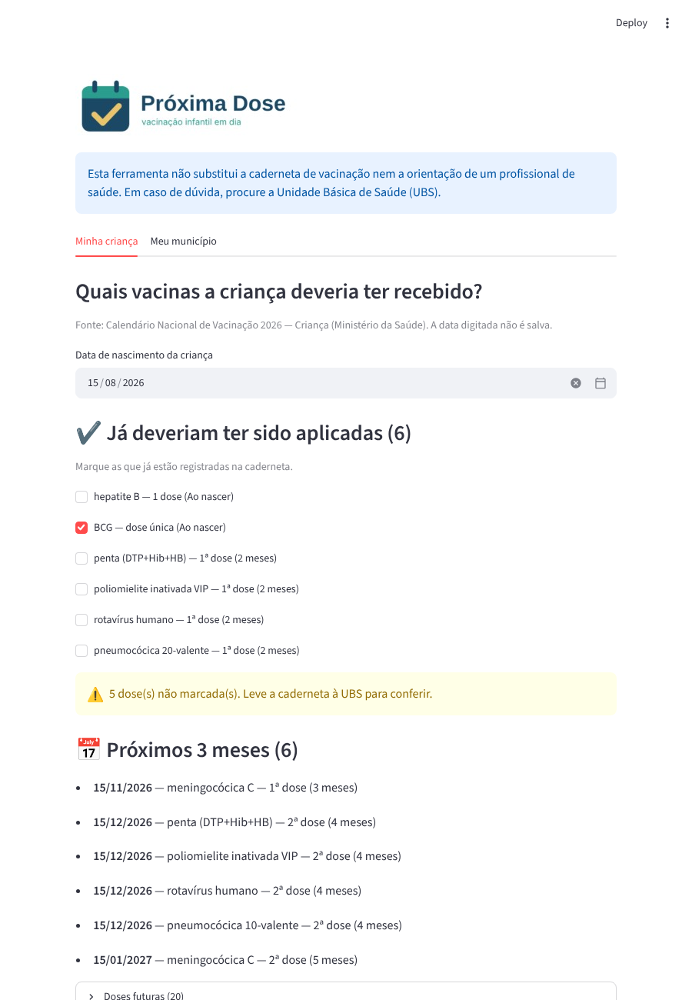
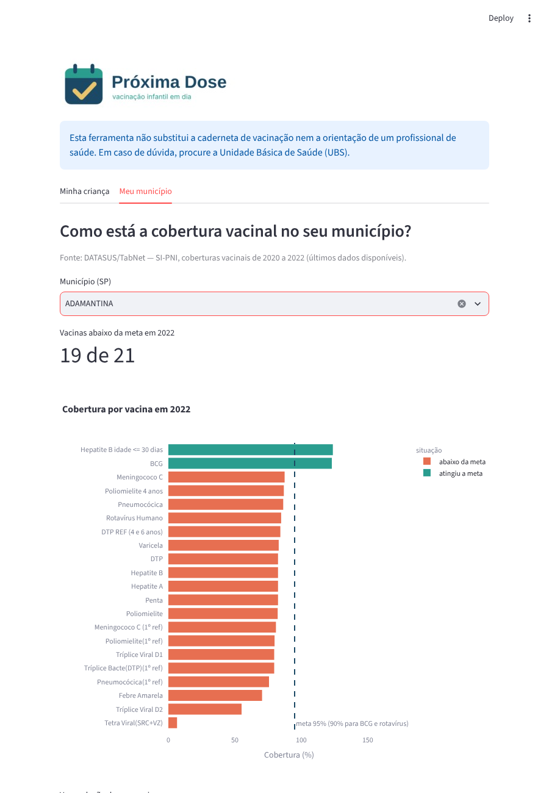

<p align="center">
  
</p>

# Próxima Dose

**FMU Tech Inovação · 1ª Edição · 2026.2 · ODS 3 — Saúde e Bem-Estar**

**Entrega: Checkpoint 1 — Ideação do Projeto**

> Ferramenta web simples que mostra a pais e responsáveis quais vacinas do Calendário Nacional de Vacinação a criança deveria ter recebido até agora e quais são as próximas, junto com um painel da cobertura vacinal do município feito com dados públicos do Ministério da Saúde.

---

## Integrantes

| Nome | RA | GitHub | Responsabilidades |
|------|----|--------|-------------------|
| Juan Luccas Gomes Razzano | 2026108904 | [@Razzano380](https://github.com/Razzano380) | Todas as etapas: dados, análise, aplicação, documentação e apresentação |

Curso: Ciência de Dados — 3º semestre · Turma: 262S000862 · Professor: Gerson Lourenço Gazola

---

## 1. Problema

### Qual problema queremos atacar
O calendário de vacinação infantil tem muitas vacinas e doses em idades diferentes, principalmente nos dois primeiros anos de vida. Para quem cuida da criança, nem sempre é fácil saber, olhando a caderneta, **o que já deveria ter sido aplicado e o que vem a seguir**. Uma dose esquecida pode passar despercebida até a próxima ida à unidade de saúde.

Além disso, a cobertura vacinal varia bastante entre municípios e entre vacinas. Essa informação é pública, mas fica em sistemas do DATASUS que são pouco conhecidos fora da área da saúde.

### Público e contexto
- **Público principal:** pais, mães e responsáveis por crianças de 0 a 5 anos.
- **Contexto:** consulta rápida em casa ou antes de ir à Unidade Básica de Saúde (UBS), usando a caderneta de vacinação como referência.
- **Recorte inicial dos dados de cobertura:** municípios do estado de São Paulo (pode ser ampliado depois, se houver tempo).

### Delimitação (o que o projeto **não** faz)
- Não substitui a caderneta, o registro oficial (Meu SUS Digital) nem a orientação de profissionais de saúde.
- Não indica tratamento, não avalia contraindicações e não decide se uma criança pode ou não tomar uma vacina.
- Não pede nome, CPF ou qualquer dado pessoal, e não armazena o que o usuário digita.
- Não cobre campanhas sazonais nem vacinas de adultos e idosos nesta versão.

---

## 2. Bases de dados públicas e reais

| Base | Fonte | Uso no projeto |
|------|-------|----------------|
| Calendário Nacional de Vacinação da criança | Ministério da Saúde — Programa Nacional de Imunizações (PNI), publicado em gov.br/saude | Lista de vacinas, doses e idade recomendada de cada dose. Será transcrita para um arquivo CSV, com a data da versão consultada. |
| Coberturas vacinais por município | DATASUS — TabNet / SI-PNI (Sistema de Informação do Programa Nacional de Imunizações) | Percentual de cobertura por vacina, município e ano, usado no painel. |
| Metas de cobertura por vacina | Ministério da Saúde (PNI) | Linha de referência nos gráficos (ex.: comparar a cobertura do município com a meta). |

**Status:** dados baixados em outubro de 2026. Coberturas de 2020, 2021 e 2022 para os 645 municípios de SP (o TabNet não tem anos mais recentes) e o Calendário Nacional de Vacinação 2026 — Criança, em PDF. Os arquivos originais estão em `data/raw/`.

**Dados fictícios:** no protótipo, a demonstração vai usar uma criança fictícia (apenas data de nascimento inventada). Isso será indicado na tela e no vídeo. Nenhum dado real de paciente será usado.

---

## 3. Proposta de solução tecnológica

### Como a solução ataca o problema
Uma aplicação web com duas telas:

1. **Minha criança** — o responsável informa a data de nascimento. A aplicação compara a idade com o calendário oficial e mostra três listas:
   - doses que **já deveriam ter sido aplicadas** (para conferir na caderneta);
   - doses **previstas para os próximos 3 meses**, com a data aproximada;
   - doses **futuras**.
   O usuário pode marcar as doses que já constam na caderneta, e a tela destaca o que ficou pendente, com a orientação de procurar a UBS.

2. **Meu município** — o usuário escolhe o município e vê gráficos com a cobertura de cada vacina no último ano disponível, comparada à meta, e a evolução ao longo dos anos.

### Onde entra a Ciência de Dados
- **Coleta e organização:** transformar o calendário oficial (texto) em uma tabela estruturada (vacina, dose, idade em meses).
- **Armazenamento:** carregar as tabelas limpas em um banco SQLite e consultá-las com SQL.
- **Limpeza:** padronizar os arquivos do DATASUS (nomes de municípios e vacinas, códigos IBGE, valores ausentes, coberturas acima de 100%, que podem ocorrer por causa da forma de cálculo).
- **Análise e visualização:** comparar coberturas com a meta, ver a evolução por ano e identificar quais vacinas estão mais abaixo da meta em cada município.

Não vamos usar aprendizado de máquina: o problema é de organização e visualização de informação, e regras simples (comparar idade com o calendário) resolvem a parte da criança.

### Tecnologias

| Tecnologia | Para quê | Por que escolhemos |
|------------|----------|--------------------|
| **Python 3** | Linguagem principal | É a linguagem que usamos no curso e tem bibliotecas prontas para dados. |
| **pandas** | Leitura, limpeza e análise dos CSVs | Biblioteca padrão para tabelas em Python; já vista em aula. |
| **Plotly** | Gráficos do painel | Gera gráficos interativos (passar o mouse, filtrar) com pouco código e funciona dentro do Streamlit. |
| **Streamlit** | Interface web | Permite criar telas navegáveis só com Python, sem precisar aprender HTML/JavaScript. É gratuito. |
| **SQLite** | Banco de dados com o calendário e as coberturas já limpos | Já vem junto com o Python (não precisa instalar servidor nem pagar nada) e guarda tudo em um único arquivo. Permite consultar os dados com SQL, por exemplo filtrar a cobertura de um município. Os arquivos originais baixados ficam guardados em CSV, sem alteração. |
| **pytest / testes simples** | Conferir a regra das doses | Garante que a regra continua certa quando o código muda. |
| **Git e GitHub** | Versionamento e entrega | Exigido pela atividade; permite mostrar a contribuição de cada integrante. |
| **Streamlit Community Cloud** (opcional) | Publicar a aplicação na internet | Gratuito e ligado ao GitHub. Se não der certo, a aplicação roda localmente. |

Nenhuma API paga, nenhum equipamento e nenhuma integração com sistemas de saúde.

---

## 4. Identidade visual

**Logo:** `assets/logo.svg` (versão vetorial) e `assets/logo.png`. O ícone é um calendário com um sinal de "feito", ligando a ideia de data (quando tomar) com a de vacinação em dia.

**Paleta de cores**

| Cor | Hex | Uso |
|-----|-----|-----|
| Azul-petróleo | `#1B4965` | Títulos, textos e ícone principal |
| Verde-água | `#2A9D8F` | Botões, destaques e status "em dia" |
| Amarelo | `#E9C46A` | Status "próxima dose" |
| Coral | `#E76F51` | Status "verificar na caderneta / pendente" |
| Cinza-claro | `#F7F9FB` | Fundo das telas |

Os status nunca serão indicados só pela cor: cada um terá também um texto ou ícone, para quem tem dificuldade de distinguir cores. O verde-água tem contraste baixo com fundo branco, então será usado em textos grandes e botões, não em textos pequenos.

**Tipografia** (ambas gratuitas, do Google Fonts)
- **Nunito** — títulos e nome do projeto (formas arredondadas, visual acolhedor).
- **Inter** — textos, tabelas e números (boa leitura em tamanhos pequenos).

---

## 5. Pitch inicial

Manter a vacinação de uma criança em dia depende de acompanhar várias doses em idades diferentes, e a caderneta de papel não avisa o que está faltando. O **Próxima Dose** transforma o Calendário Nacional de Vacinação em uma lista simples, a partir apenas da data de nascimento: o que já deveria ter sido aplicado, o que vem a seguir e quando. O diferencial é juntar essa consulta rápida, sem cadastro e sem coletar dados pessoais, com um painel construído a partir dos dados públicos do DATASUS, que mostra ao responsável como está a cobertura vacinal no próprio município. A ferramenta não substitui a caderneta nem o profissional de saúde: ela ajuda a família a chegar à UBS sabendo o que perguntar.

---

## 6. Planejamento

| Etapa | Período | Entregas |
|-------|---------|----------|
| Checkpoint 1 — Ideação | 19/10 a 23/10/2026 | Este README, identidade visual, fontes de dados definidas |
| Checkpoint 2 — Protótipo | 09/11 a 13/11/2026 | Aplicação Streamlit com as duas telas funcionando, dados limpos, prints e vídeo |
| Apresentação final | 07 e 08/12/2026 | Pitch de 5 min, demonstração ao vivo, repositório final, vídeo de até 3 min |

## Estrutura do repositório

```
proxima-dose/
├── README.md
├── requirements.txt
├── assets/                       # logo e prints das telas
├── data/
│   ├── raw/                      # arquivos originais baixados (sem alteração)
│   ├── calendario_crianca_2026.csv  # calendário transcrito do PDF oficial
│   └── proxima_dose.db           # banco SQLite gerado pelo script (não vai para o GitHub)
├── scripts/preparar_dados.py     # limpeza dos dados e criação do banco
├── app/
│   ├── app.py                    # telas (Streamlit)
│   └── regras.py                 # regra que calcula a situação de cada dose
└── tests/test_regras.py          # testes da regra
```

---

## 7. Como executar

**Pré-requisitos:** Python 3.10 ou mais recente e Git (ou baixar o ZIP pelo botão verde **Code → Download ZIP**).

```bash
git clone https://github.com/Razzano380/proxima-dose.git
cd proxima-dose
pip install -r requirements.txt
python scripts/preparar_dados.py   # cria data/proxima_dose.db
streamlit run app/app.py           # abre o app no navegador
```

Para conferir se a regra das doses está funcionando:

```bash
python tests/test_regras.py        # deve mostrar 6 linhas começando com "ok"
```

## 8. Prints do protótipo

**Minha criança:** a partir da data de nascimento (no exemplo, uma criança fictícia nascida em 15/08/2026), o app lista as doses que já deveriam ter sido aplicadas, as dos próximos 3 meses e as futuras.



**Meu município:** cobertura de cada vacina no último ano disponível, comparada à meta, e evolução de 2020 a 2022.



## 9. Evolução desde o Checkpoint 1

- Dados reais baixados e limpos (TabNet e calendário oficial 2026).
- Banco SQLite com as tabelas `cobertura` e `calendario`.
- Regra das doses implementada e testada.
- As duas telas funcionando no Streamlit.
- Retornos do Professor Mentor: _a registrar_.

## 10. Limitações conhecidas

- O TabNet só tem coberturas até **2022**; o painel não mostra a situação atual.
- Os nomes das vacinas nos dados de 2020–2022 não batem totalmente com o calendário de 2026 (ex.: meningocócica ACWY e pneumocócica 20-valente não aparecem nos dados antigos). Por isso o painel e a lista da criança são telas separadas.
- A regra usa meses de calendário; o calendário oficial fala em dias em alguns prazos (ex.: rotavírus).
- No PDF oficial, a 2ª dose da pneumocócica aparece como "10-valente" e as demais como "20-valente". Mantivemos como está no documento.
- A febre amarela de 6 a 8 meses (casos excepcionais) e a pneumocócica de 5 anos (só povos indígenas) não entram na lista, porque dependem de avaliação individual.
- Coberturas acima de 100% aparecem em municípios pequenos por causa da forma de cálculo do indicador.
